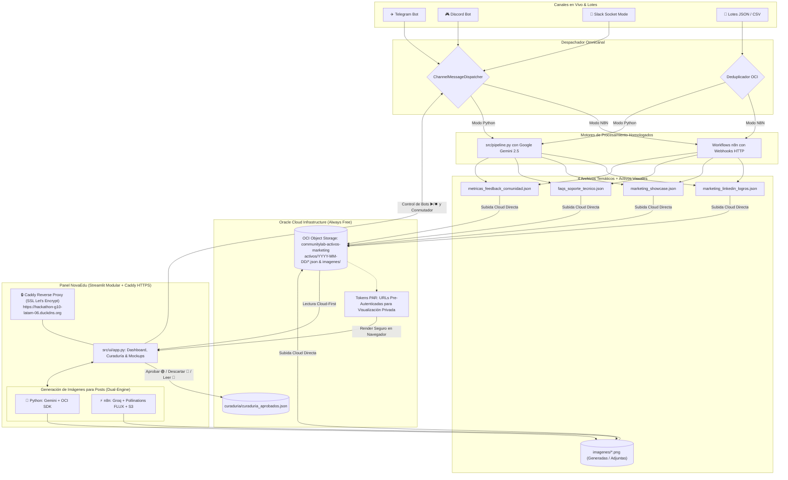

# 🚀 CommunityLab — Motor Inteligente de Transformación y Distribución para Comunidades Digitales

> **Hackathon ONE G10 — Oracle Next Education & Alura / No Country**  
> **Equipo 6 — LATAM**

---

## 📌 Descripción del Proyecto

**CommunityLab** es una plataforma inteligente de escucha activa, transformación y curaduría automatizada de contenido para comunidades técnicas de aprendizaje (Discord, Telegram, Slack o lotes de datos). 

Convierte el valor orgánico generado por estudiantes en activos listos para su distribución:
- 💼 **Publicaciones para LinkedIn & X:** Generadas a partir de contrataciones, certificaciones y logros de estudiantes.
- 📰 **Resúmenes semanales (Highlights):** Secciones estructuradas para Newsletters de comunidad.
- 💡 **FAQs y Tips Técnicos:** Detección y resolución de dudas recurrentes con snippets de código.
- 🤖 **Bots Omnicanal en Vivo:** Escucha activa en tiempo real para **Telegram** (`@G10_Latam_06_bot`), **Discord** (`G10-LATAM-06`) y **Slack** (Socket Mode), con conmutación dinámica entre Python y n8n.
- 🎨 **Generador de Imágenes Dual-Engine:** Creación visual con **Python Nativo (Gemini + OCI SDK)** o **n8n Workflow (Groq + Pollinations FLUX + OCI S3)**, con previsualización segura vía **Tokens PAR**.
- ☁️ **Persistencia Cloud:** Almacenamiento tipado y deduplicado en **Oracle Cloud Infrastructure (OCI) Object Storage (Always Free)** con soporte de tokens PAR para visualización directa.
- 🎨 **Panel NovaEdu (Streamlit Modular):** Interfaz rediseñada en 7 vistas (`components` y `views`) con seguridad administrativa (`SETTINGS_ADMIN_KEY`), selección de fuentes (OCI vs Local) y visor de mockups.
- 🌐 **Despliegue Cloud SSL:** Alojado en VM Linux **OCI Compute Always Free** con proxy inverso **Caddy**, certificados SSL Let's Encrypt y dominio DuckDNS (`https://hackathon-g10-latam-06.duckdns.org`).

---

## 🏗️ Arquitectura de la Solución (Omnicanal & Dual-Engine Cloud-Native)

CommunityLab cuenta con una **arquitectura omnicanal y dual de orquestación homologada** que permite procesar lotes históricos y mensajes en vivo, convergiendo en **Oracle Cloud Infrastructure (OCI) Object Storage** como única fuente de verdad:



---

## 👥 Equipo 6 (Integrantes y Roles)

| Integrante | Ubicación | Rol Principal |
| :--- | :--- | :--- |
| **César Augusto Cely Pulido** | Bogotá, Colombia | **Project Manager & Cloud Architect** |
| **Max Ferrer Cabanillas Salas** | Lima, Perú | **Backend & Pipeline Developer** |
| **José Medina** | Paraguay | **Oracle Ecosystem & N8N / LLMs Specialist** |
| **Edwin Gustavo Enriquez Arias** | La Paz, Bolivia | **QA Lead, Testing Automation & Backend** |
| **Carol Yesenia Arancay Osorio** | Lima, Perú | **Frontend / UX & Data** |
| **Raúl Gallardo** | Buenos Aires, Argentina | **QA & Cloud Support** |
| **Luygy Ruben Vivas Moreno** | Colombia | **QA & Pruebas Funcionales** |

---

## 📁 Estructura del Repositorio

```text
├── .streamlit/                       # Configuración Streamlit (tema light y headless)
├── docker-compose.yml                # Despliegue de n8n en contenedor Docker
├── .env.example                      # Plantilla de variables de entorno (Gemini, OCI, Bots)
├── config/
│   └── settings.example.json         # Configuración estructurada del backend
├── README.md                         # Documentación general y arquitectura
├── backend-pipeline.md               # Guía técnica de Backend y persistencia OCI
├── PM_Files/                         # Gestión del Proyecto y Metodología Ágil
│   ├── ROADMAP.md                    # Plan maestro de 5 semanas, hitos y demos
│   ├── Guion_Presentacion_CommunityLab_YouTube.md # Guion del video pitch (5 min)
│   ├── Guion_Presentacion_CommunityLab_YouTube.pdf # PDF oficial del guion
│   ├── despliegue-ssl-dominio.md     # Dominio DuckDNS, HTTPS y Caddy en OCI
│   ├── Actas_Reuniones/              # Minutas semanales de equipo
│   └── Proyecto 3 – 🚀 CommunityLab.pdf # Especificación oficial del reto
├── data/
│   └── interacciones_ejemplo.json    # Dataset de prueba con 15 interacciones
├── logs/                             # Trazas rotativas diarias de ejecución
├── n8n/                              # Orquestación de flujos
│   ├── README.md                     # Conexión a VM OCI y versionado
│   └── workflows/                    # Workflows exportados en JSON
├── src/
│   ├── ai_engine/                    # Modelos Pydantic v2 y cliente Gemini
│   ├── channels/                     # Bots omnicanal (Telegram, Discord, Slack)
│   ├── cloud_oci/                    # Conector OCI Object Storage (PAR y S3)
│   ├── ingestion/                    # Lectura, validación y deduplicación
│   ├── pipeline.py                   # Pipeline Python E2E y CLI
│   ├── ui/                           # Panel NovaEdu modular en Streamlit
│   │   ├── components/               # Header, sidebar, editor, preview, post_list
│   │   ├── views/                    # 7 Vistas desacopladas de la plataforma
│   │   ├── scripts/                  # Adaptadores, servicios UI, estado y estilos
│   │   ├── config_manager.py         # Doble persistencia (.env + JSON)
│   │   └── app.py                    # Entrada principal de Streamlit
│   └── utils/                        # Logging y utilidades transversales
└── tests/                            # Suite automatizada (82/82 tests pasando)
```

---

## ⚙️ Requisitos Previos y Configuración Local

### 1. Clonar el Repositorio
```bash
git clone git@github.com:No-Country-simulation/G10-LATAM-equipo6-CommunityLab.git
cd G10-LATAM-equipo6-CommunityLab
```

### 2. Configurar el Entorno Virtual de Python
```bash
python3 -m venv .venv
source .venv/bin/activate
pip install -r requirements.txt
```

### 3. Variables de Entorno
Copia `.env.example` como `.env` y configura tus credenciales de Gemini, OCI y Bots:
```bash
cp .env.example .env
```

### 4. Ejecución del Panel de Curaduría (Streamlit)
```bash
streamlit run src/ui/app.py
```
Accede en `http://localhost:8501` (o en la URL de producción con SSL).
- **Alto Contraste y Accesibilidad:** Botonera universal en blanco e índigo (`#3730A3`), filtros en *segmented pills* y botones de curaduría con estados dinámicos (`✅ Aprobado (Activo)`, `❌ Descartado (Activo)`, `👁️ Leído (Activo)`).
- **Descubrimiento OCI Cronológico:** Detección y ordenación de paquetes en Oracle Cloud (`activos/{YYYY-MM-DD}/*.json`), priorizando los más recientes del día.
- **Arranque Omnicanal:** Con `AUTOSTART_BOTS=true`, Telegram, Discord y Slack inician en segundo plano al arrancar la app.

### 5. Orquestador n8n
- **En la Nube:** VM OCI Always Free corriendo en [http://147.15.9.116:5678](http://147.15.9.116:5678).
- **En Local:** Ejecuta `docker compose up -d` y accede a `http://localhost:5678`.
- Consulta la guía completa en [`n8n/README.md`](n8n/README.md).

### 6. Pruebas Automatizadas & Estrategia QA
```bash
pytest tests/ -v
```
*Total:* **82 tests unitarios e integrales (100% aprobados)** cubriendo ingesta, esquemas Pydantic, cliente OCI (PAR y fallback local), bots omnicanal (Telegram, Discord, Slack), pipeline dual y generación de imágenes.  
*Estrategia QA:* Con 1 semana de ventaja antes del Demo Day, el equipo consolidó pruebas de resiliencia de bots, carga en OCI y refinamiento UX/UI.

### 7. Despliegue en Producción & Dominio SSL (OCI Always Free)
- **URL Oficial:** [`https://hackathon-g10-latam-06.duckdns.org/`](https://hackathon-g10-latam-06.duckdns.org/)
- **Infraestructura:** VM Ubuntu en Oracle Cloud Compute (`147.15.9.116`), con proxy inverso **Caddy** gestionando certificados Let's Encrypt y túnel WebSocket seguro hacia Streamlit (puerto `8501`).
- Guía detallada en [PM_Files/despliegue-ssl-dominio.md](PM_Files/despliegue-ssl-dominio.md).

---

## 📅 Roadmap de Sprints (5 Semanas)
Consulta el cronograma completo y los entregables por sprint en [ROADMAP.md](PM_Files/ROADMAP.md).
