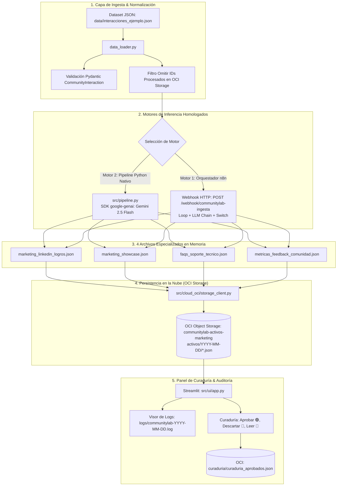

# 🛠️ Guía Técnica del Backend & Pipeline: Arquitectura, Despliegue y Replicación del Entorno

**Proyecto:** CommunityLab — Hackathon ONE G10 (Oracle & Alura / No Country)  
**Equipo:** Equipo 6 - LATAM  
**Destinatarios:** Integrantes del Equipo (Célula Frontend, Célula Cloud, Célula IA & Mentores)  
**Fecha:** 26 de octubre de 2026  
**Rama Oficial:** `main`  
**Estado:** 100% Funcional — 82/82 Tests Unitarios e Integrales Pasando (Dual-Engine Image Generator, PAR OCI Previews, Bots Omnicanal, UI NovaEdu Modular & Control de Seguridad de Settings)

---

## 📌 1. Descripción General del Sistema

**CommunityLab** es una plataforma diseñada para ingerir interacciones orgánicas de comunidades de aprendizaje técnico (como Discord, Telegram, Slack o foros de Alura / Oracle ONE), analizarlas mediante modelos de lenguaje avanzados (LLMs) y transformarlas automáticamente en:

1. **Publicaciones para Redes Sociales (LinkedIn y X):** Copys estructurados con ganchos persuasivos, lecciones aprendidas y hashtags relevantes (`marketing_linkedin_logros.json`).
2. **Showcase de Proyectos:** Casos de estudio y proyectos construidos por la comunidad (`marketing_showcase.json`).
3. **Contenido Educativo y FAQs Dinámicas:** Tips técnicos paso a paso para resolver dudas recurrentes de los estudiantes (`faqs_soporte_tecnico.json`).
4. **Métricas de Salud y Feedback:** Monitoreo de sentimiento, felicitaciones y áreas de mejora (`metricas_feedback_comunidad.json`).
5. **Persistencia Cloud-Native en OCI:** Almacenamiento seguro y estructurado de los activos en **Oracle Cloud Infrastructure (OCI) Object Storage** en la capa Always Free (`communitylab-activos-marketing`), eliminando la necesidad de persistir JSONs redundantes en el disco de la VM (Arquitectura Stateless).
6. **Bots Omnicanal en Vivo:** Escucha activa y bidireccional en segundo plano para Telegram (`@G10_Latam_06_bot`), Discord (`G10-LATAM-06`) y Slack (Socket Mode) con auto-arranque opcional (`AUTOSTART_BOTS=true`).
7. **Generador de Imágenes para Posts Dual-Engine:** Generación de creativos visuales para redes sociales conmutables entre **Python Nativo (Google Gemini + OCI SDK)** y **n8n Workflow (Groq + Pollinations FLUX + OCI S3)**.
8. **Tokens Pre-Autenticados (PAR) en OCI:** Visualización directa y segura de imágenes alojadas en buckets privados de OCI Object Storage mediante tokens de expiración temporal.
9. **Panel de Curaduría Humana NovaEdu (Streamlit Modular):** Interfaz desacoplada en 7 vistas temáticas (`dashboard`, `curation`, `ingestion`, `storage`, `connections`, `settings`, `observability`) con selector de fuente OCI/Local, visualizador de logs, mockups interactivos y control de autorización administrativa (`SETTINGS_ADMIN_KEY`).
10. **Despliegue Cloud en Producción con Caddy & SSL:** Despliegue en VM Ubuntu de OCI Compute Always Free con proxy inverso Caddy y dominio público HTTPS (`https://hackathon-g10-latam-06.duckdns.org`).

---

## 🏗️ 2. Arquitectura del Pipeline

El sistema cuenta con una **arquitectura dual de orquestación homologada** que permite ejecutar y contrastar dos motores diferentes que generan la misma estructura temática en OCI:



---

## 📁 3. Estructura de Módulos del Backend

```text
├── config/                               # Configuración estructurada del backend
│   ├── settings.json                     # Persistencia JSON local
│   └── settings.example.json             # Plantilla de configuración
├── PM_Files/                             # Gestión del Proyecto y Metodología Ágil
│   ├── ROADMAP.md                        # Plan maestro de 5 semanas, hitos y demos
│   ├── despliegue-ssl-dominio.md         # Guía de Dominio DuckDNS, HTTPS y Proxy Inverso Caddy en OCI
│   ├── Actas_Reuniones/                  # Minutas y actas de reuniones semanales
│   └── Proyecto 3 – 🚀 CommunityLab.pdf  # Especificación oficial del reto
├── data/                                 # Datasets y almacenamiento local
│   ├── interacciones_ejemplo.json        # Dataset oficial con 15 casos de prueba
│   ├── curaduria_aprobados.json          # Registro de decisiones de los Community Managers
│   └── oci_local_storage/                # Modo fallback de OCI (emulación local offline)
│       └── activos/YYYY-MM-DD/           # Paquetes JSON persistidos por fecha y motor
├── logs/                                 # Directorio de logs rotativos diarios
│   └── communitylab-YYYY-MM-DD.log       # Archivo de auditoría generado por fecha
├── n8n/workflows/                        # Workflows de n8n
│   ├── CommunityLab_Generador_Imagenes_Post.json # Microservicio síncrono de generación de imágenes
│   ├── communitylab_master_omnicanal_oci.json    # Flujo maestro unificado omnicanal
│   ├── communitylab_ingesta_local_webhook.json   # Flujo adaptado con Webhook HTTP
│   ├── communitylab_ingesta_llm.json             # Flujo original del equipo
│   ├── communitylab_telegram_dinamico.json       # Ingesta y respuesta dinámica Telegram
│   ├── communitylab_discord_dinamico.json        # Ingesta y respuesta dinámica Discord
│   ├── communitylab_slack_dinamico.json          # Ingesta y respuesta dinámica Slack
│   ├── jmedinag_WF_002.json                      # Flujo de José Medina
│   └── ingestion_groq_subflow.json               # Subflujo de Groq con persistencia S3 OCI
├── src/                                  # Código fuente principal
│   ├── ai_engine/                        # Modelos Pydantic e inferencia con Gemini
│   │   ├── schemas.py                    # Modelos de datos tipados (Pydantic V2)
│   │   ├── gemini_service.py             # Cliente oficial google-genai con fallback, backoff y generador de prompts visuales
│   │   ├── prompt_templates.json         # Plantillas de System Prompt y User Prompt
│   │   └── validator.py                  # Utilidades de limpieza de JSON/Markdown
│   ├── channels/                         # Integración omnicanal en vivo
│   │   ├── telegram_bot.py               # Bot de Telegram en hilo secundario
│   │   ├── discord_bot.py                # Bot de Discord en WebSocket Gateway
│   │   ├── slack_bot.py                  # Bot de Slack en Socket Mode
│   │   └── bot_manager.py                # Gestor OmnichannelBotManager
│   ├── cloud_oci/                        # Conector con Oracle Cloud Infrastructure
│   │   └── storage_client.py             # OCIStorageManager (Cloud + PAR + S3 + Local Fallback)
│   ├── ingestion/                        # Carga, batching y deduplicación
│   │   └── data_loader.py                # Lectura, validación y filtros de exclusión
│   ├── pipeline.py                       # Orquestador E2E y soporte para CLI
│   ├── ui/                               # Capa de presentación y servicios modular
│   │   ├── components/                   # Componentes visuales (header, sidebar, editor, preview, post_list)
│   │   ├── views/                        # 7 Vistas temáticas (dashboard, curation, ingestion, storage, connections, settings, observability)
│   │   ├── scripts/                      # data_adapter.py (normalización OCI), services.py, state.py, styles.py
│   │   ├── config_manager.py             # Gestor de doble persistencia (.env + settings.json)
│   │   └── app.py                        # Punto de entrada Streamlit
│   └── utils/                            # Utilidades compartidas
│       ├── config.py                     # Helper de configuración y toggles de servicios
│       └── logger.py                     # Logger rotativo diario (thread-safe)
└── tests/                                # Suite completa de 82 pruebas unitarias e integrales
    ├── test_ai_engine.py                 # Validación de esquemas Pydantic
    ├── test_bot_manager.py               # Pruebas del gestor omnicanal de bots
    ├── test_channels.py                  # Pruebas de integración de Telegram, Discord y Slack
    ├── test_cloud_oci.py                 # Pruebas del gestor de OCI (CRUD y PAR)
    ├── test_config.py                    # Pruebas de configuración y variables
    ├── test_gemini_service.py            # Pruebas de inferencia y resiliencia
    ├── test_ingestion.py                 # Pruebas de ingesta y deduplicación
    ├── test_oci_storage.py               # Pruebas de almacenamiento en OCI
    ├── test_pipeline.py                  # Pruebas de ejecución E2E
    └── test_ui_services.py               # Pruebas de servicios UI, PAR y generador de imágenes
```

---

## 💻 4. Guía Paso a Paso para Replicar el Entorno Local

Para Replicar en el Entorno Local seguir estos pasos:

### Paso 1: Clonar el Repositorio y Situarse en la Rama Oficial

```bash
git clone git@github.com:No-Country-simulation/G10-LATAM-equipo6-CommunityLab.git
cd G10-LATAM-equipo6-CommunityLab
git checkout main
```

### Paso 2: Crear y Activar el Entorno Virtual (Python 3.11+)

```bash
# Crear entorno virtual
python3 -m venv .venv

# Activar en Windows (PowerShell):
.\.venv\Scripts\Activate.ps1
# Activar en Linux o macOS:
source .venv/bin/activate
```

### Paso 3: Instalar Dependencias Oficiales

```bash
pip install --upgrade pip
pip install -r requirements.txt
```

### Paso 4: Configurar Variables de Entorno (`.env`)

Copia la plantilla de ejemplo y añade tus credenciales:

```bash
cp .env.example .env
```

Edita el archivo `.env` con los siguientes parámetros clave:

```ini
# API Key de Google Gemini (Gratis en https://aistudio.google.com/)
GEMINI_API_KEY=AIzaSy...

# Logging detallado diario
ENABLE_DETAILED_LOG=true
LOG_FILE_PATH=logs/communitylab.log
LOG_LEVEL=INFO

# Orquestador n8n Local
N8N_LOCAL_WEBHOOK_URL=http://localhost:5678/webhook/communitylab-ingesta

# OCI Object Storage (Si no se configuran, opera automáticamente en modo local fallback)
OCI_USER_OCID=
OCI_TENANCY_OCID=
OCI_KEY_FILE=
OCI_FINGERPRINT=
OCI_REGION=us-ashburn-1
OCI_NAMESPACE=
OCI_BUCKET_NAME=communitylab-assets
```

---

## 🧪 5. Validación del Sistema y Pruebas

### 5.1 Ejecutar Suite de Pruebas Automatizadas

Para confirmar que todos los módulos están 100% operativos:

```bash
pytest
```

**Resultado esperado:**

```text
======================= 82 passed, 25 warnings in 6.70s ========================
```

### 5.2 Ejecución por Línea de Comandos (CLI)

Puedes correr el pipeline E2E directamente en la terminal sin necesidad de interfaz gráfica:

```bash
python -m src.pipeline --input data/interacciones_ejemplo.json --limit 3
```

---

## 🌐 6. Ejecución del Panel Visual en Streamlit (NovaEdu Modular)

Para abrir la interfaz de curaduría y orquestación:

```bash
streamlit run src/ui/app.py
```

Abre tu navegador en: **`http://localhost:8501`** (o en producción vía HTTPS: `https://hackathon-g10-latam-06.duckdns.org/`).

### Las 7 Vistas Modulares Disponibles en la Interfaz:

1. 📊 **Dashboard de la Comunidad (`views/dashboard.py`):**
   - Métricas clave en tiempo real: volumen de interacciones, sentimiento neto y distribución por canal.
   - Resumen del estado de curaduría (aprobados, descartados, leídos).

2. 📝 **Curaduría de Activos Tri-Panel (`views/curation.py`):**
   - **Panel Izquierdo:** Lista de publicaciones ordenadas cronológicamente con selector de fuente (Nube OCI vs Fallback Local).
   - **Panel Central:** Editor de copys para LinkedIn y X, selector de estado y **Generador de Imágenes Dual-Engine** (conmutador entre 🐍 Python Gemini y ⚡ n8n Groq + Pollinations FLUX + OCI S3).
   - **Panel Derecho:** Mockup interactivo para previsualización fidedigna de redes sociales con renderizado seguro mediante URLs **PAR (Pre-Authenticated Requests)** para buckets privados de OCI.

3. 📥 **Procesamiento e Ingesta (`views/ingestion.py`):**
   - Controles de ejecución por lotes: límites de registros, filtros por canal y deduplicador OCI para evitar procesar interacciones duplicadas.
   - Selector dinámico de motor: **🐍 Motor Python Nativo (Gemini 2.5 Flash)** o **🌐 Motor Orquestador n8n (Webhook HTTP)**.
   - Botones para vaciado selectivo de lotes locales o del histórico en OCI.

4. ☁️ **Almacenamiento OCI Object Storage (`views/storage.py`):**
   - Explorador de paquetes temáticos en la nube (`activos/{YYYY-MM-DD}/*.json`) e imágenes persistidas.
   - Generación dinámica de tokens PAR para visualización y descarga directa.

5. 📡 **Conexiones & Bots Omnicanal (`views/connections.py`):**
   - Monitoreo en vivo de los bots de **Telegram** (`@G10_Latam_06_bot`), **Discord** (`G10-LATAM-06`) y **Slack** (Socket Mode).
   - Controles individuales y globales de encendido/apagado en tiempo real.

6. ⚙️ **Configuración & Seguridad (`views/settings.py`):**
   - Gestión de claves de API (Gemini, Groq, Telegram, Discord, Slack, OCI).
   - Blindaje de seguridad: Modificación de variables protegida por **Clave de Verificación Administrativa (`SETTINGS_ADMIN_KEY`)**.

7. 🩺 **Observabilidad & Logs (`views/observability.py`):**
   - Visor de trazas y logs rotativos en tiempo real (`logs/communitylab-YYYY-MM-DD.log`) con opciones de refresco y auditoría de eventos.

---

## 🐳 7. Levantar el Orquestador n8n Local con Docker

Probar la ejecución contra el motor de n8n:

1. **Levantar el contenedor:**
   ```bash
   docker compose up -d
   ```
2. **Acceder a n8n:**  
   Abre [http://localhost:5678](http://localhost:5678) en el navegador.
3. **Importar el Flujo Adaptado:**
   - En el menú lateral de n8n, selecciona **Workflows** -> **Import from file**.
   - Elige el archivo: `n8n/workflows/communitylab_ingesta_local_webhook.json`.
4. **Configurar Credenciales:**
   - Asigna tu clave de Groq o Gemini en las credenciales del nodo de IA.
5. **Activar el Flujo:**
   - En la esquina superior derecha, activa el interruptor a **Active (Verde)**.
6. **Ejecutar desde Streamlit:**
   - En la pestaña **⚡ Ejecutar Pipeline**, presiona el botón **`🌐 Ejecutar con Orquestador n8n`**.

---

## 📊 8. Comparativa Técnica de Motores

| Característica            | 🐍 Motor Python Nativo                        | 🔄 Orquestador n8n                 |
| :------------------------ | :-------------------------------------------- | :--------------------------------- |
| **Entorno de Ejecución**  | Proceso nativo Python (In-Process / Zero-Hop) | Contenedor Docker en puerto 5678   |
| **Modelo de IA**          | Google Gemini 2.5 Flash                       | Groq (Llama 3 / Mixtral) o Gemini  |
| **Tiempo de Respuesta**   | Ultrarrápido (~2 a 4 segundos por lote)       | Secuencial con pausas de seguridad |
| **Validación de Esquema** | Pydantic V2 estricto en código (C/Rust)       | Structured Output Parser           |
| **Archivos en OCI**       | 4 Archivos Temáticos Especializados           | 4 Archivos Temáticos Especializados|
| **Persistencia**          | Directa a Bucket OCI Always Free              | Directa a Bucket OCI Always Free   |

---

## 🤝 9. Contratos de Integración para Otras Células

- **Para la Célula Frontend (React / Next.js):**
  Los datos se exportan bajo el esquema JSON estandarizado visible en `data/paquete_procesado.json`. La lógica contenida en `src/pipeline.py` puede envolverse fácilmente en endpoints REST con **FastAPI** si el equipo desea desacoplar Streamlit.
- **Para la Célula Cloud (OCI & DevOps):**
  El módulo `storage_client.py` utiliza el SDK estándar de Oracle Cloud. Una vez configuradas las variables de entorno en la VM de producción, el pipeline comenzará a enviar los datos al Bucket real sin requerir cambios de código.
